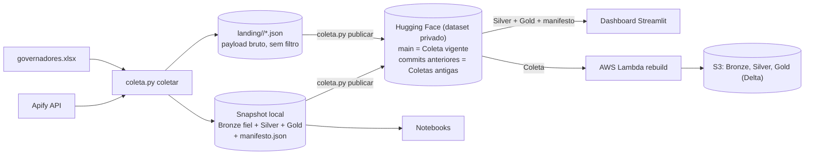
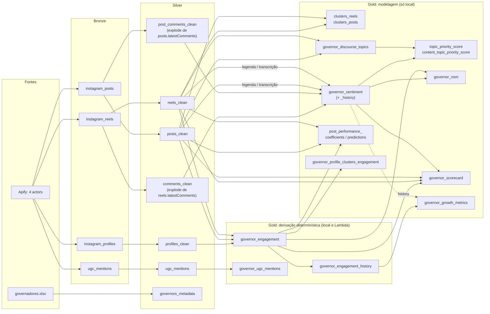

# Técnicas de NLP em Dados do Instagram

[](https://github.com/Vini0606/Tecnicas-de-Ciencia-de-Dados-em-dados-do-Instagram/actions/workflows/python-app.yml)


**Autor:** Vinícius de Paula R. Carvalho
**Trabalho de Conclusão de Curso** — Ciência de Dados e Inteligência Artificial, IESB

Pipeline de dados em **arquitetura Medallion sobre Delta Lake** que coleta os perfis de Instagram dos governadores do Brasil via [Apify](https://apify.com), grava o dado bruto fiel (Bronze), limpa e conforma (Silver), agrega e modela (Gold), versiona cada **Coleta** como um commit num dataset privado do Hugging Face e serve um dashboard Streamlit. Extração e modelagem pesada rodam localmente; a nuvem (AWS) só reconstrói uma Coleta a partir do Hugging Face.

A metodologia híbrida de NLP (sentimento + tópicos + clusterização) e os resultados do TCC estão em [`docs/pesquisa.md`](docs/pesquisa.md). Este README é sobre a engenharia: o que acontece com o dado em cada camada e entre elas.



Os termos **Coleta**, **Recorte** e **Snapshot** estão definidos em [`CONTEXT.md`](CONTEXT.md); as decisões de arquitetura, em [`docs/adr/`](docs/adr/).

---

## Sumário

1. [Visão geral do fluxo](#1-visão-geral-do-fluxo)
2. [Camadas Medallion](#2-camadas-medallion)
   - [2.1 Linhagem entre tabelas](#21-linhagem-entre-tabelas)
   - [2.2 Apify → Bronze](#22-apify--bronze)
   - [2.3 Bronze → Silver](#23-bronze--silver)
   - [2.4 Silver → Gold: derivação determinística](#24-silver--gold-derivação-determinística)
   - [2.5 Silver → Gold: modelagem](#25-silver--gold-modelagem)
   - [2.6 Contratos de schema e leitura](#26-contratos-de-schema-e-leitura)
3. [Coleta, Snapshot e Hugging Face](#3-coleta-snapshot-e-hugging-face)
4. [Reconstrução na nuvem (AWS)](#4-reconstrução-na-nuvem-aws)
5. [Estrutura do repositório](#5-estrutura-do-repositório)
6. [Como executar](#6-como-executar)
7. [Testes e CI](#7-testes-e-ci)
8. [O que o pipeline produziu](#8-o-que-o-pipeline-produziu)
9. [Dependências e documentação](#9-dependências-e-documentação)

---

## 1. Visão geral do fluxo

O fluxo é **Coleta → Snapshot → Hugging Face → dashboard / AWS** ([ADR 0039](docs/adr/0039-coleta-versionada-no-hf-bronze-fiel-e-aws-so-reconstroi.md)).

| Etapa | O que acontece | Onde |
|---|---|---|
| **Extração** | `coleta.py coletar` lê `reference/governadores.xlsx`, chama os actors da Apify para perfis, posts, reels e UGC, grava o payload bruto na `landing/` e o item filtrado pelo Recorte na **Bronze** | `src/coleta/coletar.py`, `src/data_extract/` |
| **Derivação** | Uma etapa única lê a Bronze e grava **Silver** e a **Gold de engajamento/UGC**, sem rede e sem modelo pesado. É reutilizada pela Coleta local e pela Lambda de reconstrução | `src/coleta/derivacao.py` |
| **Modelagem** | PCA, clusterização, sentimento, BERTopic e os escores derivados gravam as demais tabelas **Gold**, sob um `run_id` próprio e com checkpoint local. Só roda localmente | `src/modeling/orchestration.py` |
| **Publicação** | `coleta.py publicar` envia o Snapshot (landing + Bronze + Silver + Gold + `manifesto.json`) num único commit para a `main` do dataset privado no Hugging Face | `src/coleta/hf.py` |
| **Consumo** | O dashboard baixa Silver + Gold + manifesto do Hugging Face; os notebooks leem o Snapshot local; a AWS reconstrói as três camadas em S3 | `dashboard/`, `notebooks/`, `lambdas/rebuild/` |

**Não há histórico entre Coletas.** A Bronze é regravada a cada Coleta (`mode="overwrite"`) e uma Coleta substitui a outra como vigente; as anteriores ficam na história de commits do Hugging Face. A comparação temporal que o dashboard mostra vem de dentro de uma Coleta (datas das publicações), não de "execução vs. execução anterior". As únicas tabelas que acumulam entre execuções são `governor_engagement_history` e `governor_sentiment_history`, escritas em `append` (ver [2.4](#24-silver--gold-derivação-determinística) e [2.5](#25-silver--gold-modelagem)).

---

## 2. Camadas Medallion

| Camada | Caminho | Tabelas | Escrita por | Garante |
|---|---|---|---|---|
| **Bronze** | `data/bronze/` | `instagram_profiles`, `instagram_posts`, `instagram_reels`, `ugc_mentions` | `BronzeWriter`, via `extract_and_land` | Fidelidade: colunas tipadas + `_ingested_at`, `_run_id`, `_source` e `_raw` (o item completo da Apify). Overwrite por Coleta |
| **Silver** | `data/silver/` | `profiles_clean`, `posts_clean`, `reels_clean`, `comments_clean`, `post_comments_clean`, `ugc_mentions`, `governors_metadata` | `src/features/silver/*_cleaner.py` | Conformidade: tipos, deduplicação dentro da Coleta, timestamps parseados, comentários explodidos. Toda rejeição gera warning, nunca é silenciosa |
| **Gold** | `data/gold/` | `governor_engagement(_history)`, `governor_ugc_mentions` (derivação); `governor_sentiment(_history)`, `governor_discourse_topics`, `governor_clusters_reels`, `governor_clusters_posts`, `governor_profile_clusters_engagement`, `topic_priority_score`, `content_topic_priority_score`, `governor_nsm`, `governor_scorecard`, `post_performance_coefficients`/`_predictions`, `governor_growth_metrics` (modelagem) | `src/features/gold/*`, `src/modeling/*` | Prontidão: agregados por perfil e resultados de modelagem, cada tabela com `_run_id` e `_generated_at` |

Lista completa de colunas, tipos e linhagem por coluna: [`reference/dicionario_de_dados_medallion.xlsx`](reference/dicionario_de_dados_medallion.xlsx), gerado por `scripts/generate_data_dictionary.py` a partir de `src/schemas_delta.py`.

### 2.1 Linhagem entre tabelas



Três pontos que o diagrama mostra e uma tabela não mostraria:

- **Comentários não têm tabela na Bronze.** Eles chegam aninhados na coluna `latestComments` dos reels e dos posts, e a Silver os explode em uma linha por comentário. Por isso `comments_clean` tem muito mais linhas que `instagram_reels`.
- **`governor_sentiment` é escrita várias vezes no mesmo `run_id`:** primeiro em `overwrite` com os comentários (`fonte="comentario"`), depois em `append` com legendas e transcrições (`fonte="legenda"`/`"transcricao"`). O refino manual via Gemini reescreve só `Topic`/`Name` das linhas de comentário, preservando as outras fontes.
- **A derivação e a modelagem são dois mundos.** A derivação (`derivacao.py`) é determinística, não precisa de rede nem de GPU e roda também na Lambda; a modelagem (`orchestration.py`) baixa ~2,5 GB de modelos do Hugging Face na primeira vez e só roda localmente. A Lambda copia as tabelas de modelagem do Snapshot como estão.

### 2.2 Apify → Bronze

Código: [`src/coleta/coletar.py`](src/coleta/coletar.py), [`src/data_extract/ingestion.py`](src/data_extract/ingestion.py), [`src/data_extract/bronze_writer.py`](src/data_extract/bronze_writer.py), [`src/coleta/landing.py`](src/coleta/landing.py).

| Regra | Efeito | Por quê |
|---|---|---|
| **Ordem fixa: perfis → posts → reels → UGC**, entidade por entidade | Uma falha na escrita de uma entidade não afeta as já gravadas | Perfis/posts/reels são *fail-fast*; a Coleta já paga não é descartada por um erro posterior |
| **UGC é a última coleta e tolera falha** | Exceção do actor, lista vazia ou caminho ausente viram `ugc_mentions == []` + `ugc_error` no retorno, sem levantar | UGC é complemento ([ADR 0034](docs/adr/0034-pipeline-ponto-unico-ugc-no-extrator-comentarios-de-posts-janela-e-relatorio.md)); perfis/posts/reels não podem ser perdidos por causa dele |
| **Landing antes de qualquer filtro** ([ADR 0045](docs/adr/0045-landing-volta-como-payload-bruto-completo-de-toda-coleta.md)) | `landing/<run_id>/{profiles,posts,reels,ugc_mentions}.json` recebe a lista exatamente como a Apify devolveu, assim que cada actor responde, inclusive registros de erro e itens fora do Recorte | O dado bruto é o mais caro de refazer e os datasets da Apify expiram; a landing é a cópia fiel do que foi pago |
| **O fim do Recorte é aplicado localmente** | O actor só filtra o início da janela (`onlyPostsNewerThan`); o que está depois do fim é descartado antes da Bronze (`ScraperComLanding._filtrar`). Perfis não recebem janela | A Bronze é a tabela de trabalho, só com o Recorte pedido; o resto fica na landing |
| **Sem teto por padrão** ([ADR 0043](docs/adr/0043-coleta-sem-teto-por-padrao-teto-so-quando-explicito.md)) | Sem `--teto`, `resultsLimit` é omitido nos actors de posts, reels e UGC. Com `--teto N`, vale por perfil em cada coleção | Um teto padrão era um corte silencioso nos itens mais antigos. O actor de UGC não filtra por data, então o teto é o único freio dele ([ADR 0044](docs/adr/0044-teto-so-do-ugc-porque-o-actor-nao-filtra-por-data.md)) |
| **Listas e dicts viram JSON string** | `latestComments`, `mentions`, `taggedUsers`, `images`, `childPosts` etc. são serializados com `json.dumps` | O schema Bronze é plano; a Silver faz o parse de volta onde precisa |
| **Escalar em campo string vira texto** | Em campo que o schema declara `string`, int/float/bool viram texto (`333.0` → `"333"`, NaN → nulo) | A Apify não é consistente no tipo (ex.: `ownerId` veio int em 2 de 522 reels reais); abortar a escrita jogaria fora a extração paga |
| **Metadados de ingestão** | Cada linha recebe `_ingested_at` (UTC), `_run_id`, `_source="apify"` e `_raw` (o item completo em JSON) | Linhagem: qualquer campo que o schema não modela continua recuperável em `_raw` |
| **`write_delta(..., mode="overwrite")`** com o schema Bronze | Uma Coleta substitui a anterior na pasta de destino. Lista vazia levanta erro em vez de gravar tabela vazia | A pasta de destino de uma Coleta nova é sempre limpa (`--destino` recusa pasta não vazia); histórico fica no Hugging Face |

### 2.3 Bronze → Silver

Código: [`src/coleta/derivacao.py`](src/coleta/derivacao.py) (`derivar_silver_gold`, que lê a Bronze por `DeltaRepository.load_bronze_*`, nunca pelo `BronzeWriter`), [`src/features/silver/`](src/features/silver/). Os helpers de [`parsing.py`](src/features/silver/parsing.py) são compartilhados: `drop_duplicate_ids`, `parse_timestamp_sp` (ISO 8601 → horário de São Paulo sem timezone), `drop_invalid_timestamp`, `to_numeric_logged`. Todos registram **warning** com contagem e amostra do que foi rejeitado; nada some em silêncio.

Todos os cleaners recebem a lista de usernames de governador vinda de `governadores.xlsx` e **filtram quem não está na planilha atual**: um governador removido da planilha (ex.: sem Instagram rastreável) some da Silver mesmo estando na Bronze, e o filtro cascateia para toda a Gold.

#### `profiles_clean` ← `instagram_profiles` (`ProfileCleaner`)

| Regra | Efeito |
|---|---|
| Descarta linha sem `id` (warning com os usernames afetados) | `id` é NOT NULL no contrato; um item com erro parcial da Apify derrubaria a escrita inteira |
| Filtra `username` fora da planilha | Governador de-listado sai |
| Remove 9 colunas de ruído | `biography`, `externalUrl`, `externalUrlShimmed`, `businessAddress`, `highlightReelCount`, `url`, `profilePicUrl`, `profilePicUrlHD`, `fbid` |
| `followersCount`, `followsCount`, `postsCount`, `igtvVideoCount` → `int32`, nulo → 0 | Não numérico gera warning |
| `verified`, `private`, `isBusinessAccount`, `hasChannel`, `joinedRecently` → `bool`, nulo → `False` | Coluna vem mista True/False/None do JSON |
| Dedup por `id` (mantém a primeira) | Repetição dentro da Coleta gera warning |
| `fullName` ausente → cai para `username`, depois `inputUrl` | |
| `_source_layer = "bronze"` | |

#### `posts_clean` ← `instagram_posts` e `reels_clean` ← `instagram_reels` (`PostCleaner`)

| Regra | Efeito |
|---|---|
| Descarta linha sem `id`; filtra `ownerUsername` fora da planilha; dedup por `id` | Mesmas três regras de perfis |
| `timestamp` → `data_hora` (ISO 8601 → São Paulo sem tz); **linha com timestamp ilegível ou ausente é rejeitada** | `data_hora` é NOT NULL na Silver |
| `type` → `type_raw` | Preserva Image/Video/Sidecar da Apify, usado como preditor de Formato na regressão de performance ([ADR 0019](docs/adr/0019-regressao-de-performance-por-post-video-e-estatico-com-lasso-e-bertopic.md)) |
| `Tipo = "FEED"` (posts) ou `"REELS"` (reels) | Discriminador de formato |
| `isPinned` → bool; **nulo permanece nulo** | Preserva a diferença entre "Apify disse que não é fixado" e "Apify não informou"; a regra "nulo = não fixado" é do filtro de período do dashboard ([ADR 0041](docs/adr/0041-filtro-de-periodo-unico-e-exclusao-de-publicacoes-fixadas-nas-metricas-de-publicacoes.md)) |
| `commentsCount`, `likesCount`, `videoPlayCount`, `videoViewCount` → `int64`, nulo → 0 | |
| Só em reels: `Total de Engajamento = likesCount + commentsCount` | |
| Remove 6 colunas aninhadas | `mentions`, `images`, `childPosts`, `taggedUsers`, `coauthorProducers`, `musicInfo` |

Saldo de colunas: posts perdem 6 e ganham 4 (`data_hora`, `Tipo`, `type_raw`, `_source_layer`); reels perdem 6 e ganham 5 (as mesmas + `Total de Engajamento`).

#### `comments_clean` ← `instagram_reels.latestComments` e `post_comments_clean` ← `instagram_posts.latestComments` (`CommentCleaner`)

| Regra | Efeito |
|---|---|
| Filtra `ownerUsername` do **reel/post** fora da planilha, **antes** do explode | Depois do explode, `ownerUsername` passa a ser o autor do comentário |
| `latestComments` em JSON inválido → warning e lista vazia | Comentários daquele item são ignorados, o item em si não |
| `explode` + `json_normalize`: uma linha por comentário | Colunas homônimas são sufixadas `_reel`/`_post` e `_comment`; `ownerUsername`, `likesCount` e `timestamp` do comentário são promovidos ao nome sem sufixo |
| Remove 8 colunas de ruído herdadas do reel/post | `hashtags`, `mentions`, `images`, `childPosts`, `musicInfo`, `replies`, `taggedUsers`, `coauthorProducers` |
| `comprimento texto = len(text)`; **rejeita texto com 512 caracteres ou mais** | Limite do classificador de sentimento |
| Dedup por `id_comment` | |
| A tabela de posts só é gravada se não vier vazia | |

As duas tabelas têm a mesma estrutura, mudando só a chave (`id_reel` / `id_post`). A modelagem as une depois ([2.5](#25-silver--gold-modelagem)).

#### `ugc_mentions` ← `ugc_mentions` (`UGCMentionCleaner`)

Posts de **terceiros** que marcam ou mencionam o governador; aqui o autor é o eleitor, não o governador. A etapa inteira é tolerante a falha: Bronze de UGC ausente, Silver vazia ou exceção na limpeza viram warning e a Coleta segue.

| Regra | Efeito |
|---|---|
| Descarta linha sem `id` **e** sem `shortCode` | Registro sem nenhum dos dois não é dedupável nem rastreável |
| Dedup por chave coalescida `id ?? shortCode` | Pega duplicata cruzada (id nulo numa linha, preenchido noutra) |
| `authorUsername = authorUsername ?? ownerUsername`; `ownerUsername` é removida | Dois nomes de campo candidatos no actor |
| `governor_username` resolvido de `mentions` (lista de usernames) **e** `taggedUsers` (lista de objetos com `username`), ambos JSON, contra a lista da planilha; nulo se nenhum bater | ~69% dos posts só correlacionam via `taggedUsers`; `mentions`/`taggedUsers` são removidas depois |
| `timestamp` → `data_hora`; inválido rejeita a linha | |
| `paidPartnership` → bool, nulo → `False`; `likesCount`/`commentsCount` → `int64`, nulo → 0; `videoPlayCount` → `Int64` **anulável** | `fillna(0)` em plays apagaria a diferença entre "não é vídeo" e "vídeo com 0 plays" |

#### `governors_metadata` ← `reference/governadores.xlsx` (`GovernorsMetadataCleaner`)

Não vem da Bronze: é a planilha mantida à mão, ingerida como tabela de dimensão para o dashboard não ler Excel a cada carregamento. Seleciona `Governador`, `Unidade Federativa`, `Partido`, `Link` → `nome`, `uf`, `partido`, `inputUrl`; **descarta linha com `Link` vazio** (governador sem Instagram rastreável; `inputUrl` é a chave de junção mais usada do pipeline e é NOT NULL); `strip` em tudo; dedup por `inputUrl`; `_source_layer = "raw_xlsx"`.

### 2.4 Silver → Gold: derivação determinística

Código: [`src/coleta/derivacao.py`](src/coleta/derivacao.py), [`src/features/gold/engagement_aggregator.py`](src/features/gold/engagement_aggregator.py), [`src/features/gold/ugc_mentions_aggregator.py`](src/features/gold/ugc_mentions_aggregator.py). Roda dentro de `coleta.py coletar` e dentro da Lambda de reconstrução, com o mesmo código.

#### `governor_engagement` ← `profiles_clean` + `posts_clean` + `reels_clean` (`EngagementAggregator`)

Uma linha por perfil.

| Passo | Detalhe |
|---|---|
| `concat(posts, reels)` e **dedup por `id`** com `max` de `likesCount`/`commentsCount` | Um Reel também aparece no grid do perfil, então o scraper de posts e o de reels capturam **o mesmo post** sob o mesmo `id`. Sem o dedup, o `groupby` somaria duas vezes |
| `groupby(ownerId, ownerUsername)`: `commentsSum`, `likesSum`, `minData`, `maxData`, `count` | |
| `merge` **left** com perfis; perfil sem publicação recebe 0 nos agregados | O contrato declara esses campos não anuláveis |
| `TOTAL ENGAJAMENTO = commentsSum + likesSum` | |
| `_WC_COMENTARIO = likes totais / comentários totais` da Coleta ([ADR 0018](docs/adr/0018-realinhar-engajamento-e-matriz-de-quadrantes-ao-relatorio-vhl-sem-produto-deputados.md)) | Comentário custa mais atenção que curtida; o peso é calibrado pela própria base, não arbitrado. Sem comentário nenhum, cai para 1.0 |
| `% ENGAJAMENTO = (likesSum + commentsSum × Wc) / followersCount` | Seguidores ≤ 0 → 0.0 |
| `RECENCIA = 1 / (dias desde a última publicação do perfil + 1)` | Perfil sem publicação recebe 0, não o máximo (sem o tratamento explícito, `fillna(0)` em `maxData` faria ausência de dado virar recência máxima) |
| `FREQUENCIA = count / (dias entre a primeira e a última publicação + 1)` | |
| `_run_id`, `_generated_at` | |

A mesma DataFrame é gravada duas vezes: em `governor_engagement` (`overwrite`) e em **`governor_engagement_history`** (`append` na Coleta local; `overwrite` na Lambda, para a reconstrução ser idempotente). A pasta de destino de uma Coleta começa vazia, então o histórico só acumula se a mesma pasta receber várias execuções.

#### `governor_ugc_mentions` ← `ugc_mentions` Silver (`GovernorUGCAggregator`)

**Uma linha por post de UGC**, não por governador: a agregação por governador é uma view em memória (`aggregate_by_governor`), que nunca é persistida e nunca expõe `authorUsername` individual, só contagens e médias (privacidade de cidadãos comuns). O único enriquecimento é `is_organic = not paidPartnership`, calculado **antes** de qualquer agregação, para publi paga nunca contar como apoio espontâneo no funil. `paidPartnership`, `_ingested_at` e `_source_layer` são removidas.

### 2.5 Silver → Gold: modelagem

Código: [`src/modeling/orchestration.py`](src/modeling/orchestration.py) (`run_deterministic_modeling`), [`src/features/gold/model_enricher.py`](src/features/gold/model_enricher.py) e os módulos de `src/modeling/`. Disparada por `coleta.py coletar --modelar` ou `scripts/run_modeling.py`. Cunha um **`run_id` próprio** (o da Coleta vai no checkpoint como `parent_run_id`, só para rastreabilidade, [ADR 0001](docs/adr/0001-separar-modelagem-em-etapas-deterministicas-e-refinamento-manual.md)). As fichas de cada modelagem (método, avaliação, status) estão em [`docs/modelagens/`](docs/modelagens/README.md).

Ordem dos estágios e tabelas gravadas:

| # | Estágio | Lê | Grava | Tolera falha? |
|---|---|---|---|---|
| 1 | PCA + `AutoClusterHPO` sobre reels | `reels_clean` | `governor_clusters_reels` (`content_type="reel"`) | não |
| 2 | PCA + `AutoClusterHPO` sobre posts do feed | `posts_clean` | `governor_clusters_posts` (`content_type="feed"`) | não |
| 3 | `combine_comment_sources`: une comentários de reels e de posts, **dedup por `id_comment` preferindo a linha de reel**, marca `origem_comentario` | `comments_clean`, `post_comments_clean` | — | — |
| 4 | Sentimento (`cardiffnlp/twitter-xlm-roberta-base-sentiment`) → pré-processamento → BERTopic | saída de 3 | `governor_sentiment` (`overwrite`, `fonte="comentario"`) e `governor_sentiment_history` (`append`) | não |
| 5 | Score ICE de tópicos de comentário | saída de 4 | `topic_priority_score` | não |
| 6 | NSM = (comentários positivos / totais) × (`TOTAL ENGAJAMENTO` / `count`) | saída de 4 + `governor_engagement` | `governor_nsm` | não |
| 7 | Sentimento de **legenda** (`posts.caption`) e **transcrição** (`reels.transcript`) | `posts_clean`, `reels_clean` | `governor_sentiment` e `_history` (`append`, `fonte="legenda"`/`"transcricao"`) | não |
| 8 | BERTopic sobre legenda + transcrição (um corpus só, `nr_topics="auto"`) | saída de 7 | `governor_discourse_topics` | não |
| 9 | Score ICE por **pauta** (comentários agrupados pelo tópico da legenda do reel em que foram feitos) | saídas de 4 e 8 | `content_topic_priority_score` (provisório; recalculado no refino) | sim |
| 10 | Regressão Lasso de performance por post (vídeo / estático) | `posts_clean`, `reels_clean`, `governor_engagement` | `post_performance_coefficients`, `post_performance_predictions` | sim |
| 11 | `AutoClusterHPO` sobre **perfis** por engajamento | `governor_engagement` | `governor_profile_clusters_engagement` | sim |
| 12 | Escore composto (Scorecard: Alcance, Ativação, Qualidade, Profundidade, Consistência; min-max 0–100; pesos iguais) | `governor_engagement`, reels, posts, saída de 4 | `governor_scorecard` | sim |
| 13 | Checkpoint | — | `data/model_checkpoints/<run_id>/` (`topic_model`, modelo de discurso, PCA, clustering, DataFrames) | — |

"Tolera falha" = a exceção é logada e só aquela escrita é pulada; os estágios anteriores não são desfeitos.

Decisões que explicam a forma das tabelas:

- **Duas tabelas de clusters, não uma.** `posts_clean` e `reels_clean` se sobrepõem (um Reel também é capturado pelo scraper de posts); uma tabela única duplicava o mesmo post sob dois `content_type`, às vezes com `cluster_label` diferente.
- **`governor_sentiment` acumula três fontes** (`comentario`, `legenda`, `transcricao`) na mesma tabela. NSM, Score ICE e Scorecard filtram `fonte == "comentario"`; legenda e transcrição nunca contam como reação do público.
- **Sem alcance real.** O Instagram não expõe alcance de post estático, então "alcance" no NSM é `TOTAL ENGAJAMENTO / count` e, nos Scores ICE, a soma de curtidas + respostas dos comentários do tópico. São proxies de intensidade, declarados como tal em toda tela que os consome.
- **Scorecard com dimensão pendente.** Consistência (CMGR por data de publicação) só é calculável quando um perfil tem 4 meses com pelo menos 3 posts; enquanto isso, o escore usa 4 dimensões com peso 0,25 cada e `n_dimensoes` registra quantas entraram ([ADR 0030](docs/adr/0030-escore-composto-scorecard-com-consistencia-por-cmgr-de-engajamento-por-data-de-publicacao.md)).
- **Clusters não têm histórico.** Só `governor_engagement_history` e `governor_sentiment_history` acumulam.

Fora do `run_deterministic_modeling`, duas etapas separadas:

- **Refino manual via Gemini** (`scripts/refine_topics.py`, [ADR 0001](docs/adr/0001-separar-modelagem-em-etapas-deterministicas-e-refinamento-manual.md)): carrega o checkpoint, reescreve `Topic`/`Name` das linhas de comentário em `governor_sentiment` (preservando legenda/transcrição) e de `governor_discourse_topics`, e recalcula `content_topic_priority_score`. **Nunca grava nas `_history`** e nunca é chamado pela CLI da Coleta: é revisão humana, e o texto gerado vira citação no TCC. Até ele rodar sobre a Coleta vigente, os rótulos de pauta no dashboard são os provisórios do BERTopic.
- **`governor_growth_metrics`** (`scripts/run_growth_metrics.py`): CMGR de audiência e retenção de sentimento positivo, calculados sobre as duas tabelas `_history`; `overwrite`. Com poucas execuções acumuladas o resultado é ilustrativo e a coluna `confiavel` diz isso ao consumidor. Hoje sem consumidor no dashboard.

### 2.6 Contratos de schema e leitura

- **[`src/schemas_delta.py`](src/schemas_delta.py)** declara um schema PyArrow por tabela, com `nullable=False` nas camadas Silver e Gold. **[`src/delta_io.py`](src/delta_io.py)** (`write_delta`) conforma o DataFrame ao contrato antes de gravar: descarta colunas extras, cria as anuláveis ausentes e **falha** se um campo obrigatório vier vazio. É por isso que os cleaners rejeitam linha sem `id` ou sem `data_hora` antes da escrita, com warning, em vez de deixar a escrita inteira quebrar.
- **[`src/repositories/delta_repository.py`](src/repositories/delta_repository.py)** é a única porta de leitura de **dado** das três camadas (`bronze_dir`, `silver_dir`, `gold_dir`), local ou S3 via `storage_options`, para dashboards, notebooks e para a própria derivação Silver/Gold. É **read-only por design** (`save()` levanta `NotImplementedError`); a escrita pertence aos writers de cada camada, que por sua vez só escrevem ([ADR 0046](docs/adr/0046-leitura-de-dado-passa-pelo-repositorio-writers-so-escrevem.md)). Metadados de tabela (contagem de linhas, histórico de commits, cópia entre storages) podem usar `DeltaTable` direto; são os casos de `manifesto.py`, `pipeline_report.py`, `reconstruir._copiar_tabela` e `scripts/inspect_runs.py`. `DeltaRepository(as_of_version=N)` faz time travel numa tabela Delta local. Acessores novos levam a camada no nome (`load_bronze_*`, `load_silver_*`); os antigos sem prefixo continuam, e três deles enganam pelo nome: `load_profiles()` lê a Gold `governor_engagement`, `load_comments()` prefere a Gold `governor_sentiment` e `load_ugc_mentions()` lê a Gold `governor_ugc_mentions`.

```python
repo = DeltaRepository(gold_dir=settings.GOLD_DIR, silver_dir=settings.SILVER_DIR, bronze_dir=settings.BRONZE_DIR)
df = repo.load_profiles()          # Gold governor_engagement (nome legado)
df = repo.load_silver_profiles()   # Silver profiles_clean
df = repo.load_bronze_reels()      # Bronze instagram_reels, com _raw
repo_v3 = DeltaRepository(settings.GOLD_DIR, as_of_version=3)
```

- Os notebooks de [`notebooks/diagnostico_medallion/`](notebooks/diagnostico_medallion/) ([ADR 0022](docs/adr/0022-notebooks-de-diagnostico-medallion-separados-da-narrativa-do-tcc.md)) são estritamente leitura: volumetria, nulos e duplicatas da Bronze e da Silver, e um notebook por domínio da Gold.

---

## 3. Coleta, Snapshot e Hugging Face

`coleta.py` (módulo [`src/coleta/`](src/coleta/)) é o caminho único para extrair, publicar, restaurar, listar e baixar Coletas ([ADR 0039](docs/adr/0039-coleta-versionada-no-hf-bronze-fiel-e-aws-so-reconstroi.md); convenções em [`docs/agents/coletas.md`](docs/agents/coletas.md)).

| Comando | O que faz |
|---|---|
| `coletar` | Extrai um **Recorte** da Apify (`--dias N`, ou `--inicio`/`--fim`, e opcionalmente `--teto N`) para uma pasta de dados **limpa** (`--destino`), grava landing, Bronze, Silver, Gold de engajamento/UGC e o `manifesto.json`. Sem `--yes`, só mostra a estimativa de custo. `--modelar` roda também a modelagem (exige `DATA_DIR=<destino>`) |
| `publicar <pasta>` | Publica o Snapshot no Hugging Face como a Coleta vigente: **um único commit** de substituição na `main` (`push: <identificador>`). Sem `--yes`, só mostra o plano. Recusa identificador já publicado, Snapshot cuja landing não bate com o manifesto e ultrapassar `--limite-bytes` |
| `restaurar <coleta>` | Traz uma Coleta antiga (identificador, tag de uso ou hash de commit) de volta para a `main`, como novo commit `restore: <identificador>_restaurada` |
| `listar` | Lista as Coletas da história da `main` (identificador, commit, Recorte, data e tags de uso) |
| `baixar <coleta> --destino <pasta>` | Baixa o Snapshot de uma Coleta (landing incluída por padrão; `--sem-landing` a pula) |
| `landing <pasta>` | Registra no manifesto uma landing já presente na pasta de um Snapshot (Coleta extraída antes da [ADR 0045](docs/adr/0045-landing-volta-como-payload-bruto-completo-de-toda-coleta.md)) |

- **Identificador:** `coleta_<extração>[_<janela>][_<teto>][_<rótulo>]` (ex.: `coleta_2026-11-08_de-2026-08-16_ate-2026-10-25_tcc`). Nunca se repete; duas Coletas com o mesmo Recorte no mesmo dia exigem `--rotulo`.
- **Snapshot** = `landing/` + `bronze/` + `silver/` + `gold/` + `manifesto.json`. Checkpoints de modelagem e logs não sobem.
- **Manifesto** (v6): identidade, Recorte pedido, cobertura real por fonte e perfil, custo (estimado = média + 3σ da base de calibração, [ADR 0042](docs/adr/0042-custo-do-manifesto-estimado-por-media-mais-3-desvios-maximo-e-diferenca-percentual.md)), tabelas derivadas com contagem de linhas e o bloco `landing` (itens e bytes por fonte). Sem conteúdo (nomes, textos) nem segredos. É a fonte de verdade sobre o que foi extraído.
- **A `main` guarda só a Coleta vigente.** As anteriores ficam na história de commits e nunca são apagadas nem reescritas (sem force-push). Tags (`tcc`, `reboot-iesb`) são só de uso.
- **Custo:** três coleções pagas (posts, reels, UGC). Re-extrair uma janela maior repaga o período sobreposto, porque uma Coleta substitui a outra, não a complementa.

O card do dataset, com a Coleta vigente e o que cada pasta contém, está em [`docs/dataset/README.md`](docs/dataset/README.md).

---

## 4. Reconstrução na nuvem (AWS)

A nuvem **não extrai nem agenda** ([ADR 0039](docs/adr/0039-coleta-versionada-no-hf-bronze-fiel-e-aws-so-reconstroi.md), decisão 8). A única Lambda, [`lambdas/rebuild/`](lambdas/rebuild/), baixa uma Coleta do Hugging Face (sem a landing) e reconstrói as três camadas como Delta em `s3://<bucket>/{bronze,silver,gold}/`: copia a Bronze do Snapshot, **re-deriva** Silver e Gold de engajamento/UGC com o mesmo `derivacao.py` (`modo_historico="overwrite"`, para ser idempotente) e copia as tabelas de modelagem como estão.

| Lambda | Lê | Escreve | Memória | Timeout | Variáveis |
|---|---|---|---|---|---|
| `rebuild/handler.py` | Snapshot da Coleta no Hugging Face | Bronze, Silver e Gold Delta no S3 | 3008 MB (+5 GB em `/tmp`) | 900 s (teto AWS) | `S3_BUCKET`, `HF_TOKEN`, `HF_DATASET_REPO` |

Roda como imagem de container (`pyarrow`/`deltalake` têm binários nativos), publicada no ECR por [`.github/workflows/build-lambdas.yml`](.github/workflows/build-lambdas.yml) a cada push em `main` que passe no CI e mexa em `lambdas/**` ou `src/**`, sem access key armazenada ([ADR 0009](docs/adr/0009-publicar-imagens-das-lambdas-via-github-actions-com-oidc.md), OIDC). [`infra/main.tf`](infra/main.tf) declara bucket S3, repositório ECR, IAM mínimo da Lambda e a role federada do GitHub Actions. **O `terraform apply` é sempre manual e nunca foi aplicado**; passo a passo e invocação em [`infra/README.md`](infra/README.md) e [`docs/operacao.md`](docs/operacao.md#reconstruir-na-nuvem-a-partir-de-uma-coleta-aws).

Limites: a reconstrução precisa caber em 15 minutos; não há retry nem DLQ (a invocação é manual e o rastro fica nos logs do CloudWatch).

---

## 5. Estrutura do repositório

```
├── coleta.py              # CLI da Coleta: coletar, publicar, restaurar, listar, baixar, landing
├── config/settings.py     # Caminhos e parâmetros, sobrescrevíveis por env var
├── src/
│   ├── coleta/            # Recorte, custo, coletar, landing, manifesto, derivacao (Silver/Gold), hf, reconstruir, cli
│   ├── data_extract/      # Scraper Apify, BronzeWriter (Bronze fiel), extract_and_land
│   ├── features/silver/   # Um cleaner por tabela Silver + parsing compartilhado
│   ├── features/gold/     # Agregador de engajamento, UGC, NSM, Scores ICE, ModelEnricher
│   ├── modeling/          # PCA, AutoClusterHPO, sentimento, BERTopic, Scorecard, growth, refino Gemini, orquestração
│   ├── repositories/      # DeltaRepository: única porta de leitura das três camadas, local ou S3
│   ├── schemas_delta.py   # Contratos PyArrow das três camadas
│   └── delta_io.py        # write_delta com validação de schema
├── dashboard/             # Streamlit "por decisão" (ADR 0021): app.py + core/ + screens/
├── lambdas/rebuild/       # Única Lambda: baixa uma Coleta do HF e reconstrói Bronze/Silver/Gold no S3
├── infra/                 # Terraform: S3, ECR, Lambda, role OIDC do GitHub Actions
├── notebooks/             # 01-07 narrativa do TCC · diagnostico_medallion/ (leitura) · modelagens/ (avaliação)
├── scripts/               # run_modeling, refine_topics, run_growth_metrics, run_governor_scorecard, inspect_runs, generate_data_dictionary
├── tests/                 # pytest
├── data/                  # Efêmero, fora do git: landing/, bronze/, silver/, gold/, manifesto.json, model_checkpoints/, logs/
├── reference/             # governadores.xlsx (entrada manual) + dicionario_de_dados_medallion.xlsx (gerado)
├── reports/academic/      # TCC em LaTeX, figuras
└── docs/                  # adr/ · agents/ · dataset/ (card do HF) · modelagens/ (fichas) · pesquisa.md · operacao.md
```

---

## 6. Como executar

### Pré-requisitos

- **Python 3.10+**
- [uv](https://docs.astral.sh/uv/) — `pip install uv`

### Do zero

`data/` começa vazia no clone. Há dois caminhos: **baixar** uma Coleta já publicada (sem custo) ou **extrair** uma nova (custo real na Apify).

```bash
git clone https://github.com/Vini0606/Tecnicas-de-Ciencia-de-Dados-em-dados-do-Instagram.git
cd Tecnicas-de-Ciencia-de-Dados-em-dados-do-Instagram
uv sync --extra dev
cp .env.example .env      # editar: APIFY_API_TOKEN (extrair) e HF_TOKEN + HF_DATASET_REPO (publicar/baixar)
```

**Caminho A. Baixar uma Coleta já publicada (sem custo):**

```bash
uv run python coleta.py listar
uv run python coleta.py baixar <identificador> --destino data
uv run streamlit run dashboard/app.py          # http://localhost:8501
```

**Caminho B. Extrair uma Coleta nova (Apify, custo real):**

```bash
# Sem --yes, só mostra o Recorte e a estimativa de custo; nada é gasto nem escrito.
# O destino deve ser uma pasta LIMPA, nunca a data/ em uso.
uv run python coleta.py coletar --inicio 2026-08-16 --fim 2026-10-25 --destino C:\dados\coleta_nova

# Extração de verdade: landing, Bronze, Silver, Gold de engajamento/UGC e manifesto.json
uv run python coleta.py coletar --inicio 2026-08-16 --fim 2026-10-25 --destino C:\dados\coleta_nova --yes

# (opcional, pesado) incluir a modelagem; exige DATA_DIR apontando para o destino
#    PowerShell: $env:DATA_DIR = "C:\dados\coleta_nova"
uv run python coleta.py coletar --inicio 2026-08-16 --fim 2026-10-25 --destino C:\dados\coleta_nova --yes --modelar

# Publicar como a Coleta vigente: sem --yes mostra o plano; com --yes envia um único commit
uv run python coleta.py publicar C:\dados\coleta_nova
uv run python coleta.py publicar C:\dados\coleta_nova --yes

# Testes e lint
uv run pytest tests/ -v --cov=src --cov-report=term-missing
uv run ruff check src/
```

| Flag do `coletar` | Efeito |
|---|---|
| `--dias N` | Janela relativa: só publicações dos últimos N dias (`onlyPostsNewerThan`) |
| `--inicio AAAA-MM-DD` / `--fim AAAA-MM-DD` | Intervalo absoluto do Recorte; o fim é aplicado localmente |
| `--teto N` | Teto de itens por perfil em cada coleção. **Sem ele, a Coleta é sem teto** ([ADR 0043](docs/adr/0043-coleta-sem-teto-por-padrao-teto-so-quando-explicito.md)); a primeira Coleta de uma conta exige `--teto`, porque sem base de calibração não há estimativa |
| `--rotulo texto` | Rótulo no fim do identificador (minúsculas, dígitos e `-`) |
| `--destino pasta` | Obrigatória. Pasta limpa; o comando recusa pasta não vazia |
| `--yes` | Confirma o gasto real. Sem ele, só imprime a estimativa |
| `--modelar` | Roda também a modelagem (~15–30 min; na primeira vez baixa ~2,5 GB de modelos) e imprime o relatório de tabelas |

Com `--modelar`, a CLI termina com um relatório por tabela esperada (`OK`, `AUSENTE`, `VAZIA`, `DESATUALIZADA`, `NAO SOLICITADA`) e sai com **1** se alguma tabela lida pelo dashboard não estiver OK. Os fluxos de manutenção (re-rodar só a modelagem, refino via Gemini, deploy no Streamlit Cloud, levar dados para outra máquina, AWS, `inspect_runs`) estão em [`docs/operacao.md`](docs/operacao.md).

### Variáveis de ambiente

| Variável | Obrigatória | Padrão | Descrição |
|---|---|---|---|
| `APIFY_API_TOKEN` | Só para coleta nova | — | Token da API Apify |
| `DATA_DIR` | Não | `data` | Raiz dos dados (Bronze/Silver/Gold); `--modelar` exige que aponte para o `--destino` |
| `RANDOM_STATE` | Não | `42` | Semente de reprodutibilidade |
| `API_GEMINI` | Só para `scripts/refine_topics.py` | — | Chave do Gemini para o refino manual de tópicos |
| `HF_TOKEN` | Para publicar, baixar, listar e no dashboard publicado | — | Token fine-grained do Hugging Face, com acesso só ao dataset |
| `HF_DATASET_REPO` | Idem | — | Dataset privado `<usuario>/<nome>` com as Coletas |
| `HF_DATASET_REPO_PUBLICACAO` | Não | `HF_DATASET_REPO` | Dataset separado só para o dashboard ([ADR 0036](docs/adr/0036-dashboard-no-streamlit-cloud-com-silver-e-gold-baixados-do-hugging-face.md)) |
| `HF_DATASET_REVISAO` | Não | `main` | Tag ou commit que o dashboard mostra, em vez da Coleta vigente |
| `APP_PASSWORD` | Obrigatória fora do `localhost` | — | Senha do dashboard publicado ([ADR 0037](docs/adr/0037-dashboard-exige-senha-no-proprio-app.md)) |
| `JANELA_ALERTA_NEGATIVIDADE_DIAS` | Não | `7` | Janela (dias) da comparação do Radar de crise |
| `S3_BUCKET`, `S3_BASE_PREFIX`, `S3_*_PREFIX` | Só em cloud | — / `bronze/` `silver/` `gold/` | Bucket e prefixos da Lambda rebuild (lidas pelo handler, não por `settings.py`) |

Lista completa em [`config/settings.py`](config/settings.py).

---

## 7. Testes e CI

**1.132 testes** coletados por `pytest` (em `tests/`), cobrindo Bronze fiel, cada cleaner da Silver, conformação de schema, agregadores e escores da Gold, módulo Coleta e CLI, Lambda de reconstrução e cada tela do dashboard. [`.github/workflows/python-app.yml`](.github/workflows/python-app.yml) roda a cada push e pull request na `main`: Python 3.11, pytest com cobertura e `ruff check src/`.

---

## 8. O que o pipeline produziu

Cruzando a clusterização dos reels (métrica) com o sentimento dos comentários (qualitativo), cada cluster ganha uma leitura que nenhuma das duas análises produziria sozinha:

| Cluster | Positivo | Neutro | Negativo | Leitura |
|---|---|---|---|---|
| **0** — Padrão (792 reels) | 72,3% | 14,1% | 13,7% | Aprovação consistente |
| **-1** — Viral (12 reels) | 53,5% | 25,7% | 20,8% | **Polarizado**: viralidade movida tanto por aclamação quanto por controvérsia |
| **1** — Longo (6 reels) | 60,4% | **27,1%** | 12,5% | **Indiferença**: maior taxa de neutros; falha em provocar reação |

Em uma frase: **o conteúdo padrão é aprovado, o viral é debatido, e o longo é ignorado.** "Alto engajamento" não é sinônimo de "alta aprovação". Contexto, metodologia (PCA, `AutoClusterHPO`, sentimento, BERTopic) e figuras em [`docs/pesquisa.md`](docs/pesquisa.md).

---

## 9. Dependências e documentação

Núcleo: **`deltalake`** e **`pyarrow`** para as tabelas Delta e os contratos de schema; **`pandas`** em todo o pipeline; **`transformers`** e **`torch`** para sentimento; **`bertopic`** e **`sentence-transformers`** para tópicos; **`scikit-learn`** e **`hyperopt`** para PCA e `AutoClusterHPO`; **`streamlit`** e **`plotly`** para o dashboard; **`apify-client`** e **`huggingface_hub`** para coleta e publicação. Versões em `pyproject.toml` e `uv.lock`.

| Documento | O que é |
|---|---|
| [`docs/pesquisa.md`](docs/pesquisa.md) | Contexto do TCC, metodologia híbrida, resultados e figuras |
| [`docs/operacao.md`](docs/operacao.md) | Fluxos alternativos e manutenção |
| [`CONTEXT.md`](CONTEXT.md) | Glossário de domínio (Coleta, Recorte, Snapshot, pauta…) |
| [`docs/adr/`](docs/adr/) | Registro das decisões de arquitetura |
| [`docs/modelagens/`](docs/modelagens/README.md) | Uma ficha por modelagem: método, avaliação, status |
| [`docs/dataset/README.md`](docs/dataset/README.md) | Card do dataset no Hugging Face: Coleta vigente e conteúdo de cada pasta |
| [`docs/agents/`](docs/agents/) | Convenções para agentes de IA (issues, labels, Coletas) |
| [`reference/dicionario_de_dados_medallion.xlsx`](reference/dicionario_de_dados_medallion.xlsx) | Catálogo das tabelas e colunas das três camadas, com linhagem |
| [`infra/README.md`](infra/README.md) | Provisionamento AWS passo a passo |

O pipeline legado baseado em Excel foi removido ([ADR 0013](docs/adr/0013-remover-pipeline-legado-excel-e-artefatos-de-migracao-ja-concluida.md)); a única leitura de `.xlsx` que resta é `reference/governadores.xlsx`, a lista de perfis a coletar.
