# A pesquisa: metodologia híbrida de NLP e resultados do TCC

**Autor:** Vinícius de Paula R. Carvalho
**Trabalho de Conclusão de Curso** — Ciência de Dados e Inteligência Artificial, IESB

Este documento reúne o contexto acadêmico, a metodologia e os resultados do TCC. A engenharia de dados que sustenta tudo isso (camadas Medallion, Coleta versionada, dashboard) está no [README](../README.md) do repositório.

O trabalho **propõe e valida uma metodologia híbrida de Processamento de Linguagem Natural**: em vez de aplicar análise de sentimentos, modelagem de tópicos e clusterização isoladamente, integra as três e demonstra que a combinação revela o que nenhuma delas mostra sozinha. O estudo de caso são os perfis de Instagram dos **27 governadores do Brasil**.

O achado central, em uma frase: **o conteúdo padrão é aprovado, o viral é debatido, e o longo é ignorado.** Nenhuma das três técnicas, isolada, chega a essa conclusão.

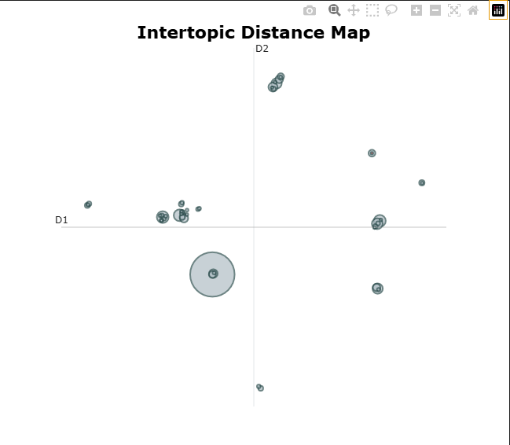

Mapa de distância intertópica dos 50 temas identificados por BERTopic no corpus de comentários. Círculos próximos são semanticamente similares; o tamanho é proporcional à frequência do tópico.

---

## 1. Contexto da pesquisa

### O problema

As mídias sociais se consolidaram como plataformas centrais na formação da opinião pública, mas o volume e a natureza não estruturada dos comentários tornam a análise manual impraticável. A lacuna que este trabalho ataca não é a falta de ferramentas — é o fato de que as abordagens tradicionais aplicam essas ferramentas **isoladamente**. Medir apenas a polaridade do sentimento não diz *sobre o quê* o público reage; extrair apenas tópicos não diz *como* o público reage; agrupar apenas por métricas não diz *nada* sobre conteúdo.

### A hipótese

A integração sinérgica de análise de sentimentos, modelagem de tópicos e clusterização produz uma leitura da percepção pública mais granular do que a soma das partes.

### Objetivo geral

> Desenvolver e validar uma metodologia de modelagem híbrida baseada em Processamento de Linguagem Natural que combine análise de sentimentos, modelagem de tópicos e técnicas de clusterização para análise de publicações e comentários de redes sociais.

### Objetivos específicos

1. Estruturar um pipeline de processamento de dados textuais (limpeza, normalização, preparação)
2. Aplicar análise de sentimentos para identificar polaridades
3. Implementar modelagem de tópicos para extrair os temas discutidos
4. Aplicar clusterização para agrupar publicações por semelhança
5. Validar em estudo de caso real — os governadores do Brasil
6. **Comparar com abordagens isoladas**, evidenciando as vantagens da integração

O objetivo nº 6 é o que diferencia o trabalho: não basta aplicar as três técnicas, é preciso provar que juntas valem mais.

### O corpus

| Dimensão | Volume |
|---|---|
| Perfis de governadores | 27 (todos verificados e públicos) |
| Posts do feed | 810 |
| Reels | 810 |
| Comentários coletados | ~13.500 (6.777 em reels + 6.749 em posts) |

Coleta via [Apify](https://apify.com), a partir da lista curada em `reference/governadores.xlsx`. Os números acima são os da Coleta usada no TCC. A Coleta vigente no Hugging Face (ver o [card do dataset](dataset/README.md)) pode ter volumes diferentes.

### Por que engenharia de dados em um TCC de NLP

Esta é uma decisão de projeto deliberada, não excesso de escopo. Um resultado acadêmico precisa ser **reproduzível**: qualquer número citado no texto do TCC deve poder ser recuperado meses depois, exatamente como estava. Um pipeline que sobrescreve arquivos Excel não oferece isso.

A arquitetura Medallion sobre Delta Lake resolve o problema com três garantias:

- **Coletas versionadas** — cada Coleta fica salva como um commit no dataset privado do Hugging Face, identificada pela mensagem `push: coleta_...` e pelo manifesto ([ADR 0039](adr/0039-coleta-versionada-no-hf-bronze-fiel-e-aws-so-reconstroi.md)); a mais recente é sempre a vigente e qualquer número do TCC pode ser refeito a partir do commit (as tags são só de uso, como `tcc` ou `reboot-iesb`)
- **Time travel** — `DeltaRepository(as_of_version=…)` recupera uma versão anterior de uma tabela Delta local
- **Linhagem** — a Bronze guarda o item completo da Apify na coluna `_raw` e os metadados `_run_id`, `_ingested_at` e `_source`; o `manifesto.json` de cada Coleta registra Recorte pedido, cobertura real, custo e contagem de linhas
- **Contratos de schema** — `src/schemas_delta.py` declara os tipos de cada camada, com `nullable=False` nas camadas Silver e Gold como validação *fail-fast*

Os detalhes de cada camada estão no [README](../README.md#2-camadas-medallion).

---

## 2. Metodologia híbrida e resultados

As quatro técnicas são aplicadas em sequência, cada uma alimentando a seguinte. Os resultados abaixo estão documentados em `reports/academic/Capítulos/Capitulo_05_Modelagem.tex`.

### 2.1 PCA — redução dimensional

As métricas numéricas dos reels foram reduzidas a dois componentes que retêm **92% da variância**:

| Componente | Variância | Interpretação | Carga dominante |
|---|---|---|---|
| PC1 | 67% | Índice de Engajamento | `likesCount` 0.59 · `videoPlayCount` 0.57 · `commentsCount` 0.56 |
| PC2 | 25% | Fator de Duração | `videoDuration` 1.00 |

A separação é limpa: PC1 mede repercussão, PC2 mede duração, e um não contamina o outro. Isso torna a clusterização subsequente interpretável.

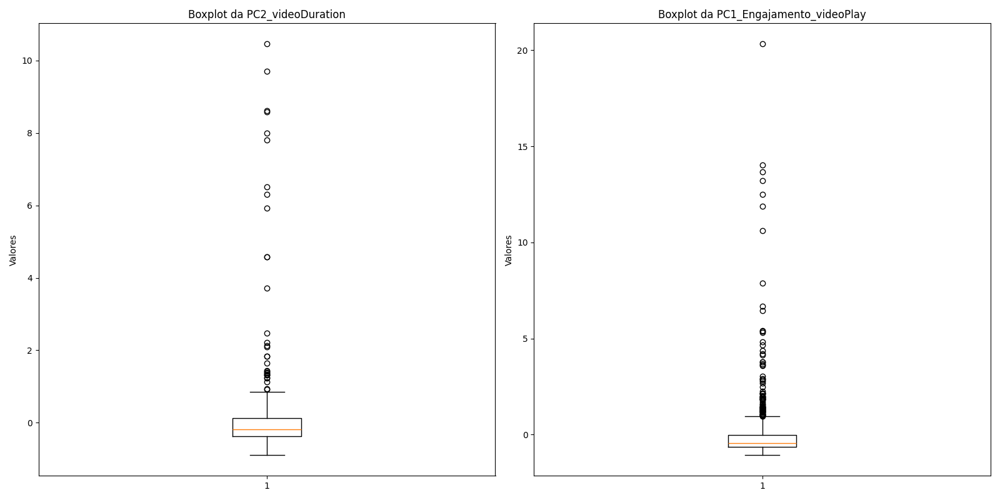

Distribuição de PC1 (Engajamento) e PC2 (Duração). A longa cauda de outliers positivos em ambos é o que justifica escolher, na etapa seguinte, um algoritmo robusto a outliers.

### 2.2 Clusterização automática — `AutoClusterHPO`

`src/modeling/clustering.py` é a peça original do trabalho. Em vez de arbitrar o número de clusters, ele conduz uma busca automatizada:

- Testa **KMeans, DBSCAN e Agglomerative Clustering**, cada um com seu próprio espaço de hiperparâmetros
- Otimiza via **TPE (Hyperopt)**, 50 avaliações por algoritmo
- Avalia com um **score CVI combinado** — Silhouette + Calinski-Harabasz normalizado por `tanh(chi/10000)` + Davies-Bouldin invertido por `tanh(1/dbi)` ([`clustering.py`](../src/modeling/clustering.py))
- Filtra os pontos de ruído do DBSCAN antes de calcular os índices, evitando a distorção que invalidaria a comparação entre algoritmos

**Resultado:** o framework elegeu **DBSCAN** (`eps=1.40`, `min_samples=5`) com score CVI combinado de **0.6594**, encontrando três grupos:

| Cluster | Reels | Perfil | Duração média |
|---|---|---|---|
| **0** — Padrão | 792 | Engajamento moderado e consistente | 64,5 s |
| **-1** — Viral | 12 | ~4.843 comentários, ~90k curtidas, 1,12M views | 26–900 s |
| **1** — Longo / Baixa performance | 6 | Pior desempenho em todas as métricas | 721 s (~12 min) |

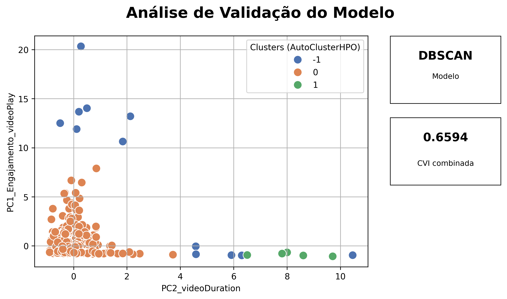

Os três grupos no espaço PC1 × PC2. O DBSCAN isolou automaticamente os reels de performance anômala no rótulo de ruído (-1).

### 2.3 Análise de sentimentos

Modelo `cardiffnlp/twitter-xlm-roberta-base-sentiment` via `transformers` — especializado em texto de redes sociais, classifica em `positive` / `neutral` / `negative` e devolve um score de confiança.

O modelo classificou a maioria dos comentários com alta confiança. As classes `positive` e `negative` apresentam scores consistentemente mais altos que `neutral` — comportamento esperado, já que neutralidade é semanticamente mais ambígua.

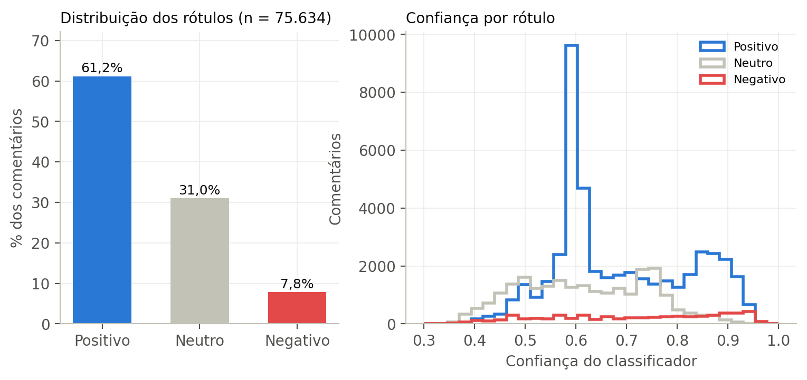

(a) Distribuição de rótulos · (b) Distribuição dos scores de confiança · (c) Boxplot de scores por sentimento.

Nos extremos por perfil, a assimetria é brutal: **Clécio Luís** com 92,01% de comentários positivos, contra **Ibaneis** com 51,89% de negativos — mais da metade das interações em seu perfil são críticas. Não existe "governador médio".

<table>
<tr>
<td width="50%">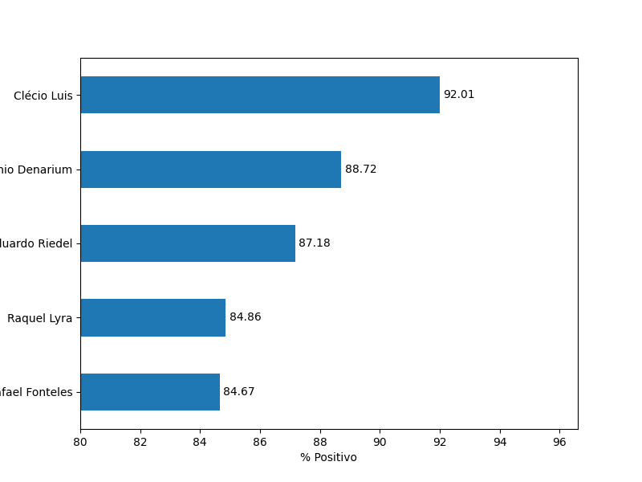</td>
<td width="50%">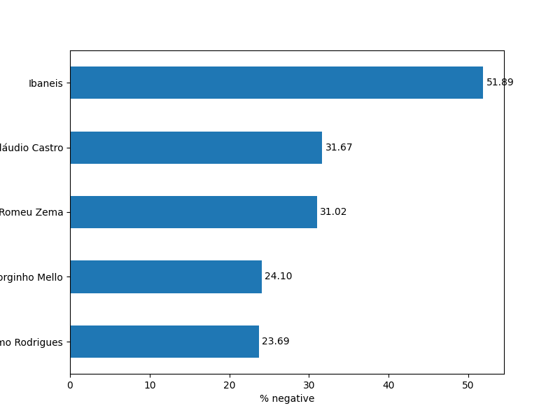</td>
</tr>
<tr>
<td align="center">Maior percentual de comentários <b>positivos</b></td>
<td align="center">Maior percentual de comentários <b>negativos</b></td>
</tr>
</table>

### 2.4 Modelagem de tópicos — BERTopic

BERTopic com embeddings de `sentence-transformers` e redução via UMAP identificou **50 temas distintos** no corpus. O mapa de distância intertópica está no topo deste documento; abaixo, as duas visões complementares da estrutura desses temas.

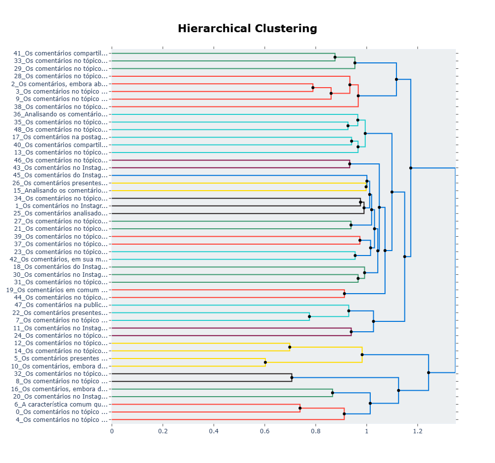

Dendrograma da clusterização hierárquica dos tópicos — mostra como os 50 temas se agrupam em famílias semânticas.

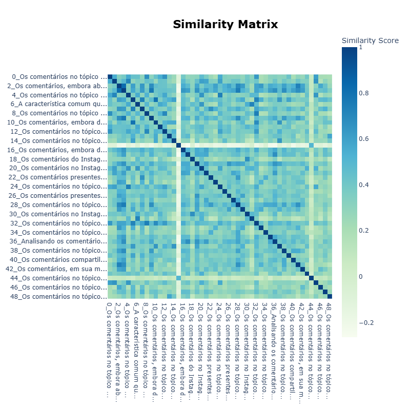

Matriz de similaridade entre os tópicos. Blocos quentes na diagonal indicam grupos de temas correlacionados.

### 2.5 O cruzamento — onde a tese se prova

Esta é a etapa que responde ao objetivo específico nº 6. Cruzando a clusterização (métrica) com a análise de sentimentos (qualitativa), cada cluster ganha um significado que nenhuma das análises isoladas produziria:

| Cluster | Positivo | Neutro | Negativo | Leitura |
|---|---|---|---|---|
| **0** — Padrão | 72,3% | 14,1% | 13,7% | Aprovação consistente |
| **-1** — Viral | 53,5% | 25,7% | 20,8% | **Polarizado** — viralidade movida tanto por aclamação quanto por controvérsia |
| **1** — Longo | 60,4% | **27,1%** | 12,5% | **Indiferença** — maior taxa de neutros; falha em provocar reação |

<table>
<tr>
<td width="33%">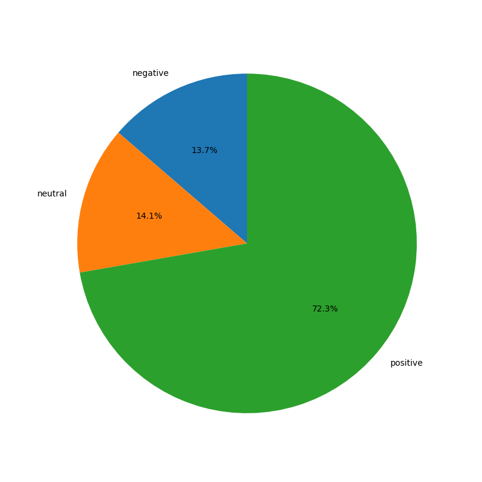</td>
<td width="33%">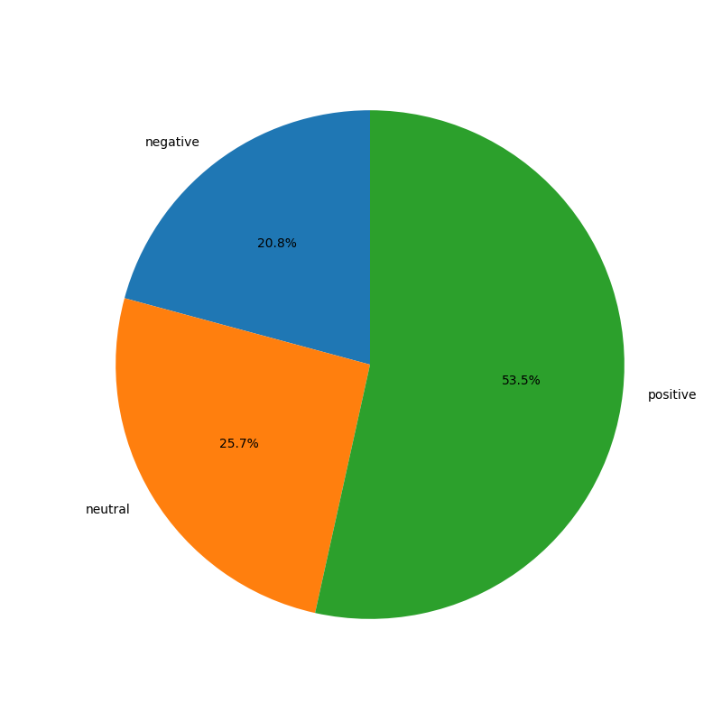</td>
<td width="33%">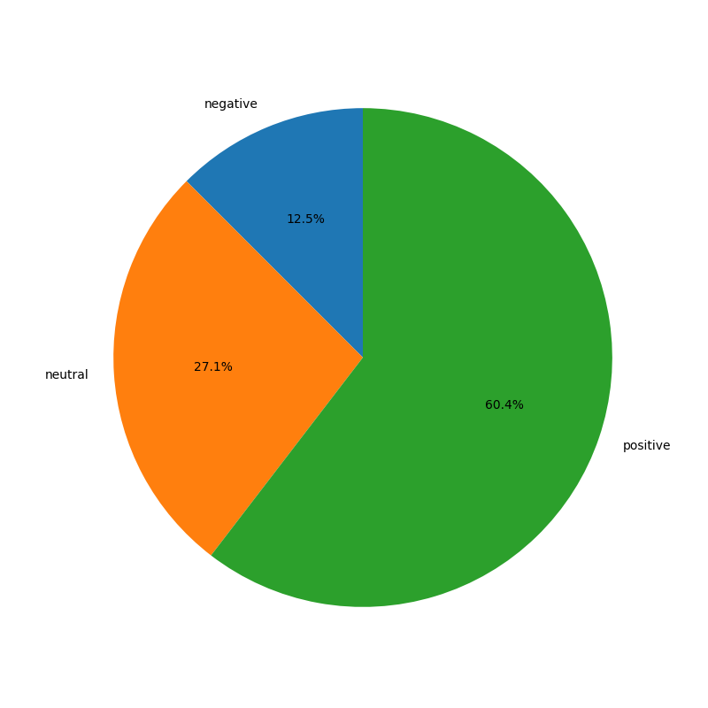</td>
</tr>
<tr>
<td align="center"><b>Cluster 0</b> — Padrão aprovado</td>
<td align="center"><b>Cluster -1</b> — Viral debatido</td>
<td align="center"><b>Cluster 1</b> — Longo ignorado</td>
</tr>
</table>

A conclusão que só a abordagem híbrida permite: **"alto engajamento" não é sinônimo de "alta aprovação"**. O cluster com as métricas mais fortes é também o mais polarizado. O cluster de pior desempenho não gera rejeição — gera indiferença.

---

## 3. Onde a pesquisa vive no repositório

| Recurso | Onde |
|---|---|
| TCC completo (LaTeX, 7 capítulos) | `reports/academic/` |
| Metodologia e resultados detalhados | `reports/academic/Capítulos/Capitulo_05_Modelagem.tex` |
| Catálogo de modelagens (fichas vivas: o que é, como foi avaliado, em que pé está) | [`docs/modelagens/`](modelagens/README.md) |
| Notebooks da narrativa do TCC | `notebooks/01` a `07` (extração e limpeza, EDA, modelagem híbrida, visualização, regressão de performance) |
| Bibliografia | `reports/academic/IESB-CDeIA-Bibliografia.bib` |
| Figuras geradas | `reports/figures/` |
| Dicionário de dados legado (era pré-Medallion, `Profiles.json`) | `reports/academic/Dicionário de Dados.xlsx` — artefato histórico do TCC, não reflete o schema atual |

### Pendências

- Os capítulos 6 (Resultados) e 7 (Conclusões) do TCC ainda estão no texto-modelo, embora os resultados já existam e estejam redigidos no capítulo 5.
- O refinamento dos rótulos de tópico via Gemini (`scripts/refine_topics.py`, [ADR 0001](adr/0001-separar-modelagem-em-etapas-deterministicas-e-refinamento-manual.md)) é uma etapa de revisão humana cujo texto vira citação no TCC; até ele rodar sobre a Coleta vigente, os rótulos são os provisórios do BERTopic.
